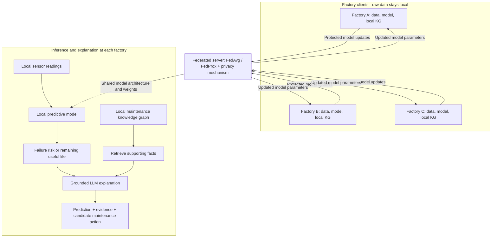

# FedMaint-AI
### Privacy-Preserving Predictive Maintenance with Federated Learning, Knowledge Graphs, and LLMs

> **Status:** Planning and dataset verification. Both research datasets are currently checked into this public repository; no predictive model, federated pipeline, privacy mechanism, knowledge graph, or LLM explanation system has been implemented or evaluated yet.
>
> This repository is a **research prototype under development**, not a production or safety-certified predictive-maintenance tool.

**Navigate:** [Overview](#overview) · [Quick start](#quick-start) · [Status](#current-implementation-status) · [Architecture](#proposed-system-architecture) · [Datasets](#datasets) · [Technology choices](#proposed-technology-stack) · [Roadmap](#implementation-roadmap) · [Evaluation](#evaluation-plan) · [Project plan](docs/ROADMAP.md) · [References](#sources-and-references)

## Overview

Industrial equipment continuously generates sensor measurements, operating logs, maintenance events, and failure histories. Predictive maintenance uses this information to anticipate failures and reduce unexpected downtime. However, real organizations may be unable to pool equipment data because of privacy, confidentiality, or organizational constraints.

**FedMaint-AI** explores a collaborative approach where simulated factories train predictive-maintenance models using **federated learning (FL)** without sending their raw training data to a central server. It also explores **privacy-preserving model aggregation**, a **maintenance knowledge graph (KG)**, and **large language models (LLMs)** for evidence-grounded explanations and maintenance recommendations.

The research objective is to evaluate **predictive performance, generalization to previously unseen factories, privacy–utility trade-offs, communication cost, and explanation faithfulness**. This is a research prototype, not an industrial safety or maintenance decision system.

## Current implementation status

The repository now includes **a documented project scaffold**, dataset files and manifest, and a verification script. Python module stubs organize future work; they are **not implemented functionality**. For detailed phases and completion gates, see [PROJECT ROADMAP](docs/ROADMAP.md) and the [decision log](docs/DECISIONS.md).

| Area | Status | What's available now |
| --- | --- | --- |
| Project description and architecture | Phase 1 draft | This README, [architecture](docs/ARCHITECTURE.md), [data flow](docs/DATA_FLOW.md), and [model design](docs/MODEL_DESIGN.md); choices still await review |
| Repository scaffold and phase plan | Set up | `src/fedmaint/`, `configs/`, `experiments/`, `tests/`, and [`docs/ROADMAP.md`](docs/ROADMAP.md) (no functional pipeline yet) |
| Dataset provenance and checksums | Available | [`data/manifest.json`](data/manifest.json) |
| Dataset verification | Available | [`scripts/prepare_data.py`](scripts/prepare_data.py) checks committed datasets directly; original ZIP extraction remains optional |
| Data exploration, cleaning, labeling | Not started | To be designed and implemented |
| Centralized/local ML baselines | Not started | Planned experiments only |
| Federated training and privacy | Not started | Methods proposed, not implemented |
| Knowledge graphs and LLM explanations | Not started | Architecture proposed, not implemented |
| Results, ablations, and final integration | Not started | No published experimental results |

## Quick start

### Requirements

- **Python 3.9+** and **Git**. Dataset verification uses only Python's standard library.
- **No additional data download is required** after cloning the complete repository; both datasets are currently committed. The clone includes roughly 120 MB of dataset files.

### Clone and verify the uploaded datasets

```bash
git clone https://github.com/momen320230161-hub/FedMaint-AI.git
cd FedMaint-AI

# Verify both committed datasets directly; do not extract any ZIP:
python scripts/prepare_data.py --verify-only

# Or verify one dataset:
python scripts/prepare_data.py --verify-only --dataset azure
python scripts/prepare_data.py --verify-only --dataset nasa
```

The script automatically checks the following current paths:

| Dataset | Tracked path | Expected files |
| --- | --- | --- |
| Azure | [`data/Azure Data/`](data/Azure%20Data) | 5 CSV files |
| NASA C-MAPSS | [`data/CMAPSSData/`](data/CMAPSSData) | 12 TXT data files, plus source README and PDF |

For each expected data file, the script checks its **row count** and **accepted exact SHA-256 hash** against [`data/manifest.json`](data/manifest.json). It exits with a nonzero status if any file is missing or altered.

### Optional: prepare original ZIP archives locally

You **do not need** these commands when the tracked folders above exist. If you have the originally supplied ZIPs and prefer a local extraction:

```bash
python scripts/prepare_data.py --azure-zip "/path/to/archive (2).zip"
python scripts/prepare_data.py --nasa-zip "/path/to/CMAPSSData.zip"
```

ZIP extraction uses the original archive hashes in the manifest and writes to Git-ignored `data/raw/azure/` and `data/raw/nasa/`. `--verify-only` prefers the tracked folders and falls back to `data/raw/` if those are absent.

**Checksum note:** Azure CSVs in the original ZIP use CRLF line endings, while those committed to Git use LF. Each Azure file has a source `sha256` and a verified `repository_sha256`; either exactly listed hash is accepted, but arbitrary file changes are not. NASA TXT data files match their original hashes.

**Not yet implemented:** This script does not preprocess data, train models, or run federated learning.

## Project objectives

1. Predict machine failures over a defined future horizon and/or estimate **remaining useful life (RUL)**.
2. Simulate multiple factories with **non-identically distributed (non-IID)** data.
3. Compare **local-only**, **centralized**, **FedAvg**, and **FedProx** training under controlled conditions.
4. Evaluate a privacy mechanism such as **differential privacy** or **secure aggregation**; distinguish FL from a formal privacy guarantee.
5. Represent machines, components, sensors, errors, failures, and maintenance events through a shared **ontology** and **local knowledge graphs**.
6. Generate explanations and candidate maintenance actions grounded in actual model outputs and retrieved KG facts.
7. Evaluate generalization on a **held-out factory** that was never used to train the global model.
8. Report results across multiple runs, appropriate baselines, and ablation studies.

## Proposed system architecture



**Privacy boundary:** Telemetry and identifiable maintenance records are intended to remain at each client. Model updates are not inherently private; the design must evaluate possible leakage from both updates and any shared knowledge-graph content. The exact placement and threat model of the privacy mechanism will be documented before experiments.

## Proposed technology stack

The following tools are **candidates**, not installed project dependencies or finalized implementation choices. Select and pin versions when each phase begins.

| Layer | Candidate tools | Intended role |
| --- | --- | --- |
| Data analysis and feature engineering | Python, pandas, NumPy, scikit-learn | EDA, transformations, baselines and metrics |
| Sequence-based predictive models | PyTorch (LSTM/GRU or other tested backbone) | Time-series models for failure risk and RUL |
| Federated orchestration | Flower or a documented custom simulation | FedAvg/FedProx clients, rounds and communication tracking |
| Privacy research | Opacus (for a compatible DP design) or a secure-aggregation implementation | Privacy experiments with a defined threat model |
| Knowledge graph | NetworkX for prototyping; Neo4j if persistence/query needs justify it | Client-local graph construction and fact retrieval |
| Explanation generation | An LLM with explicit evidence retrieval and validation | Faithful, traceable maintenance explanations |
| Reproducibility | Git, experiment configuration files, fixed random seeds | Comparable and repeatable evaluations |

**Design note:** A shared graph **ontology** is proposed, while factory-specific graph facts remain local unless a separate privacy assessment permits sharing. A graph-neural-network backbone is optional in the project description; a knowledge graph does not require a GNN.

## Datasets

The two datasets support **separate experiments**. Their labels, measurement scales, and underlying processes differ; they should not be casually combined into one training table.

### 1. Microsoft Azure Predictive Maintenance — primary end-to-end benchmark

**Source:** [Microsoft Azure Predictive Maintenance on Kaggle](https://www.kaggle.com/datasets/arnabbiswas1/microsoft-azure-predictive-maintenance)

| File | Records in the supplied archive | Purpose |
| --- | ---: | --- |
| `PdM_telemetry.csv` | 876,100 | Hourly voltage, rotation, pressure, vibration |
| `PdM_errors.csv` | 3,919 | Machine error events |
| `PdM_maint.csv` | 3,286 | Component replacement / maintenance history |
| `PdM_failures.csv` | 761 | Component failure events |
| `PdM_machines.csv` | 100 | Machine metadata, model, and age |

There are **100 simulated machines** across **four machine models** in the supplied data. A **proposed** task is to predict failure within the next 24 hours, with the prediction horizon and label definition fixed *before* model training. Train/validation/test splits must respect time and machine identities. Maintenance and failure records must never leak future information into predictors.

**Why Azure first?** Its linked machine, component, error, failure, and maintenance tables provide a practical foundation for the KG and explanation pipeline. It is still a **synthetic/simulated benchmark**, not evidence of deployment readiness.

### 2. NASA C-MAPSS — RUL and cross-domain FL benchmark

**Source:** [NASA Open Data Portal: CMAPSS Jet Engine Simulated Data](https://data.nasa.gov/dataset/cmapss-jet-engine-simulated-data)

C-MAPSS contains engine run-to-failure sequences with operational settings and sensor measurements. Each subset includes `train_FD00x.txt`, `test_FD00x.txt`, and `RUL_FD00x.txt`.

| Subset | Training rows | Testing rows | Operating conditions | Fault modes |
| --- | ---: | ---: | ---: | ---: |
| FD001 | 20,631 | 13,096 | 1 | 1 |
| FD002 | 53,759 | 33,991 | 6 | 1 |
| FD003 | 24,720 | 16,596 | 1 | 2 |
| FD004 | 61,249 | 41,214 | 6 | 2 |

A proposed task is **RUL regression** in operating cycles. The NASA test labels indicate remaining cycles *after each test engine's last observed cycle*; they are not pointwise labels for every earlier cycle without further reconstruction. The FD subsets differ materially, so leave-one-domain-out results must be interpreted carefully and reported separately.

**Note:** C-MAPSS does not contain the same explicit maintenance-action history as Azure; it should not be used to invent component-level maintenance explanations.

## Dataset availability, layout, and redistribution

**Both datasets are currently tracked in this public repository** under `data/Azure Data/` and `data/CMAPSSData/`. Earlier documentation that called raw data untracked is now outdated. The alternative `data/raw/` location remains Git-ignored for optional local extraction.

```text
data/
├── Azure Data/                # Tracked: Azure CSV files
│   ├── PdM_telemetry.csv
│   ├── PdM_errors.csv
│   ├── PdM_maint.csv
│   ├── PdM_failures.csv
│   └── PdM_machines.csv
├── CMAPSSData/                # Tracked: NASA TXT files and original docs
│   ├── train_FD001.txt ... train_FD004.txt
│   ├── test_FD001.txt  ... test_FD004.txt
│   ├── RUL_FD001.txt   ... RUL_FD004.txt
│   ├── readme.txt
│   └── Damage Propagation Modeling.pdf
├── manifest.json             # Tracked: hashes, sources, row counts
└── raw/                      # Optional local extraction; ignored by Git
    ├── azure/
    └── nasa/
```

**Redistribution and repository-size considerations:**

- Public availability is not itself proof of permission to republish third-party datasets. The Azure Kaggle listing has shown an **unknown license**, and the NASA resource page does not clearly state a dataset license. Verify the applicable permissions.
- The tracked Azure telemetry CSV is about **79 MB**, and large Git blobs can make cloning and history maintenance difficult.
- Removing a tracked file in a future commit does not remove earlier Git history. If redistribution is not authorized, addressing already published copies/history is a separate repository decision.
- Manifest hashes demonstrate file integrity, **not** redistribution permission.

## Implementation roadmap

The phases below are **planned work**, with the repository scaffold established in Phase 0. Detailed deliverables and exit gates: [docs/ROADMAP.md](docs/ROADMAP.md); protocol: [docs/EXPERIMENT_PROTOCOL.md](docs/EXPERIMENT_PROTOCOL.md).

| Phase | Work | Expected deliverable | Status |
| --- | --- | --- | --- |
| 0. Repository foundation | Set up folders, manifests, docs and working plan | Structure and phase definitions | Scaffold complete |
| 1. Requirements and design | Prediction tasks, privacy boundary, ontology, experimental splits | Architecture + experiment specification | Draft in progress |
| 2. Data preparation | EDA, missing-value checks, local normalization, windowing, leakage-safe labels | Reproducible feature pipeline | Not started |
| 3. Baselines | Local and pooled centralized reference models | Comparable baseline results | Not started |
| 4. Federated learning | Same predictive backbone with FedAvg and FedProx | Multi-client FL pipeline | Not started |
| 5. Privacy | Explicit threat model; DP or secure aggregation; utility analysis | Privacy–utility experiments | Not started |
| 6. Knowledge graphs | Shared ontology, client-local KG, evidence provenance | KG construction and retrieval | Not started |
| 7. LLM explanations | Ground model predictions in retrieved graph facts | Explainability pipeline | Not started |
| 8. Evaluation | Held-out clients/domains, ablations, multi-seed runs, communication cost | Reproducible results and analysis | Not started |
| 9. Integration | Research demo, documentation, final write-up | End-to-end project | Not started |

### Important experimental controls

- **Non-IID clients:** For Azure, partition machines (potentially by machine model), checking for sufficient client sample and failure counts. For NASA, FD subsets are candidate domains, not actual independent factories.
- **Held-out factory:** Reserve one distinct client or domain *before training and tuning*. Do not include its model updates, examples, normalization statistics, or validation labels in training.
- **Leakage prevention:** Compute features from observations available **at prediction time**. Keep future failures, post-failure replacements, and cross-split transformations out of inputs.
- **FL fairness:** Compare centralized, local-only, FedAvg, and FedProx using a matched model backbone and clearly defined data budgets and optimization settings.
- **Local normalization:** Learn sensor normalization parameters at each client without aggregating raw sensor values.
- **Privacy accountability:** Specify the threat model, update clipping, privacy accounting (if DP is selected), and remaining leakage limitations.
- **Grounding:** Only retrieve supported KG facts. Distinguish correlation, model attribution, and demonstrated causality. Withhold unsupported maintenance advice.

## Evaluation plan

| Task | Candidate metrics |
| --- | --- |
| Azure failure prediction | PR-AUC, F1, precision, recall, confusion matrix, calibration |
| NASA RUL prediction | RMSE, MAE, NASA asymmetric scoring function |
| Federated optimization | Per-client performance, convergence, communication volume, rounds |
| Generalization | Results on strictly held-out factories/domains |
| Privacy | Privacy budget and predictive utility (if DP); protocol assumptions (if secure aggregation) |
| KG + LLM | Evidence coverage, factual correctness, faithfulness, unsupported-claim rate |
| Ablations | Without FL, privacy, KG retrieval, and/or LLM explanations (where meaningful) |

Use multiple random seeds and report variability. No numerical accuracy, privacy guarantee, or explanation-quality improvement is claimed until experiments are performed.

## Repository layout

```text
FedMaint-AI/
├── README.md
├── .gitignore
├── data/
│   ├── Azure Data/             # Currently committed raw CSVs
│   ├── CMAPSSData/             # Currently committed NASA data
│   └── manifest.json
├── scripts/
│   └── prepare_data.py        # Dataset verification
├── src/
│   └── fedmaint/
│       ├── data/
│       ├── models/
│       ├── federated/
│       ├── privacy/
│       ├── knowledge_graph/
│       ├── explainability/
│       └── evaluation/
├── configs/                   # Experiment config guidance
├── experiments/               # Experiment logging guidance
├── tests/                     # Planned test guidance
└── docs/
    ├── ROADMAP.md
    ├── ARCHITECTURE.md
    ├── DATA_FLOW.md
    ├── MODEL_DESIGN.md
    ├── EXPERIMENT_PROTOCOL.md
    └── DECISIONS.md
```

**Current state:** The folders above contain **documentation and empty Python package stubs**; the only functional code currently in the repository is the dataset preparation/verification helper. No model training or FL privacy pipeline is available.

### Project working documents

- [Phases and completion criteria](docs/ROADMAP.md)
- **[Phase 1 data flow and client/holdout design](docs/DATA_FLOW.md)**
- **[Phase 1 model architecture (GRU candidate)](docs/MODEL_DESIGN.md)**
- [Architecture and privacy boundaries](docs/ARCHITECTURE.md)
- [Experimental protocol and leakage rules](docs/EXPERIMENT_PROTOCOL.md)
- [Open design decisions](docs/DECISIONS.md)

## Research questions

1. When does FL improve cross-factory predictive performance relative to local-only training?
2. How do FedAvg and FedProx perform as operating conditions and client data distributions diverge?
3. What is the measured cost of added privacy protection in prediction quality and communication?
4. Does KG-grounded retrieval improve the correctness and traceability of LLM maintenance explanations?
5. What fails when the model is evaluated on a factory/domain absent from training?

## Reproducibility and contribution notes

- Develop features on separate branches and use pull requests to discuss experimental changes.
- Do not add further raw datasets, trained weights, secrets, or generated output to Git without reviewing redistribution rights and repository-size impacts. Existing raw datasets require a separate permission review.
- Record preprocessing choices, split definitions, client allocations, random seeds, hyperparameters, dataset versions, and environment details for each experiment.
- Avoid sharing evaluation data with training clients or fitting normalization on held-out factory data. Assess potential privacy leakage from both model updates and retrieved KG evidence.
- Do not claim accuracy gains, privacy guarantees, or causal explanations until there is reproducible evidence. Report unsuccessful experiments and limitations too.
- No repository-wide third-party data redistribution permission is implied by this README.

## Sources and references

- [Microsoft Azure Predictive Maintenance dataset](https://www.kaggle.com/datasets/arnabbiswas1/microsoft-azure-predictive-maintenance)
- [NASA C-MAPSS simulated data](https://data.nasa.gov/dataset/cmapss-jet-engine-simulated-data)
- [NASA C-MAPSS research reference — Saxena et al., 2008](https://www.phmsociety.org/node/21)
- [GitHub repository file-size guidance](https://docs.github.com/en/repositories/working-with-files/managing-large-files/about-large-files-on-github)

---

**Maintainers:** FedMaint-AI project team.  
**Disclaimer:** Research/educational use; not a safety-certified maintenance decision tool.
