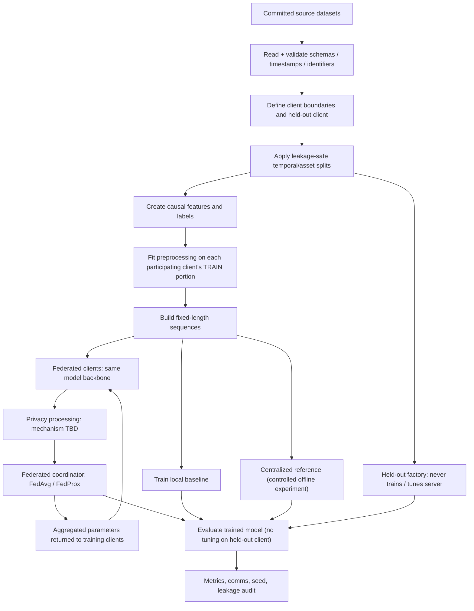
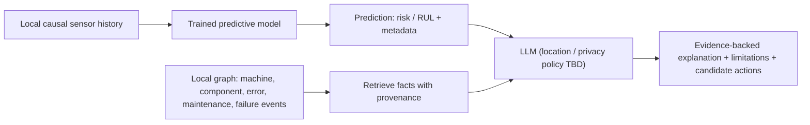

# Phase 1 & 2 — End-to-End Data Flow

> **Status Notice:** Phase 2B (Azure Leakage-Safe Data Preparation) is staged and pending Codex real-data verification gates. Downstream stages (Phases 3–9: Predictive Baselines, Federated Learning, Privacy Mechanisms, Knowledge Graphs, and LLM Explanations) and the NASA C-MAPSS track remain **unimplemented design proposals**.

## 1. Two experimental tracks

| Track | Source files | Training task | Target | Role |
| --- | --- | --- | --- | --- |
| **A — Azure (primary)** | `data/Azure Data/PdM_*.csv` | Failure classification | Binary failure risk over future 24h horizon | Federated classification, KG, LLM explanations |
| **B — NASA C-MAPSS** | `data/CMAPSSData/{train,test,RUL}_FD*.txt` | RUL regression | Remaining engine cycles until failure | RUL and cross-domain generalization benchmark |

**Keep the two tracks separate.** They may reuse code and protocols, but do not pool the input arrays or mix target definitions.

## 2. High-level training flow

The centralized baseline is an **offline comparison**, not the privacy-preserving deployment path. The specific privacy mechanism and leakage threat model are not finalized.

## 3. Azure: approved Phase 2B operational flow

### Source tables and keys

| Source | Join key | Time field | Allowed use at prediction time `t` |
| --- | --- | --- | --- |
| `PdM_telemetry.csv` | `machineID` | `datetime` | **Past-only:** 48 hourly readings in `[t-48h, t)`. **No reading at `t` or later.** Negative label eligibility requires telemetry coverage through `t+24h`. |
| `PdM_errors.csv` | `machineID` | `datetime` | Excluded from primary predictive features. Never joined into predictors at same hour. |
| `PdM_maint.csv` | `machineID` | `datetime` | Excluded from primary predictive features. Never joined into predictors at same hour. |
| `PdM_machines.csv` | `machineID` | None | Machine metadata; used only for client partitioning. Never used as predictive feature. |
| `PdM_failures.csv` | `machineID` | `datetime` | **Future records only for target creation in `(t, t+24h]`** and blackout `[t-48h, t]`. Never predictive input; omitted from sample payloads. |

### Approved Phase 2B label and window design

- **Prediction unit:** one machine at hourly prediction time `t`.
- **Task:** binary **any-component failure in `(t, t + 24h]`** (approved Phase 2B protocol).
- **Observation window:** prior **48 hourly readings** strictly in `[t-48h, t)`; stride **one hour**.
- **Outcome:** `1` if a relevant failure event occurs in `(t, t+24h]`; `0` only if this whole horizon is observable without event.
- **Right-censored exclusion:** If a machine's telemetry ends before `t+24h`, the outcome horizon is unobservable; candidate time `t` is marked right-censored and rejected (never silently emitted as negative).
- **Episode collapse:** All component failure records sharing `machineID` and exact timestamp collapse into a single failure episode. Repeated timestamps at different hours remain distinct episodes.
- **Blackout assumption:** Exclude candidate prediction time `t` if an episode occurs at `t` or in the prior 48 hours (`[t-48h, t]` inclusive). This is an explicit research assumption representing repair downtime and replacement recovery, not a physical failure onset. Failures are recorded replacement events.
- **Feature scope:** Primary pipeline features are strictly telemetry-only (`volt`, `rotate`, `pressure`, `vibration`), shape $48 \times 4$. Future event records (component identities, failure timestamps) are strictly omitted from sample payloads (`AzureSample`).
- **Overlap semantics:** Adjacent positive hourly windows share 47 of 48 observation hours. Positive windows are **not** independent failure episodes.

### Observed model distribution in the supplied Azure data

This is direct analysis of `PdM_machines.csv` joined with `PdM_failures.csv` from the project upload:

| Machine model | Machines | Failure-event records |
| --- | ---: | ---: |
| model1 | 16 | 189 |
| model2 | 17 | 168 |
| model3 | 35 | 221 |
| model4 | 32 | 183 |
| **Total** | **100** | **761** |

**These counts are not classification-positive label counts.** Class prevalence depends on windows, event handling and horizon.

### Approved client / generalization protocol (Phase 2B)

**Protocol A (approved Phase 2B):** Treat `model2`, `model3`, `model4` as three non-IID participating federated clients. Reserve all 16 machines belonging to `model1` as an **unseen-model factory** (`heldout_model1`).

- The held-out model's raw data, labels, scaler parameters and updates are excluded from **training, validation, hyperparameter selection and global-model preprocessing**. Calling `validate_split_access("train")` or `"val"` on `heldout_model1` raises `HoldoutLeakageError`.
- **Temporal splits:** half-open intervals: train `[2015-01-01 06:00, 2015-09-01 06:00)`, val `[2015-09-01 06:00, 2015-11-01 06:00)`, test `[2015-11-01 06:00, 2016-01-01 06:00)`. Boundary rule: $t - 48\text{h} \ge \text{split\_start}$ and $t < \text{split\_end}$ and strict $t + 24\text{h} < \text{split\_end}$. Neither history nor horizon crosses split boundaries.
- Evaluate held-out machines only on the final `test` split after model and thresholds are locked.
- For the required analysis of client count (Phase 4), separately repartition training machines within known models using **whole-machine assignment**, never random row assignment. Do not mix this with the primary unseen-model result.

**Risk:** Only three participating model groups in the main protocol. This is sufficient to demonstrate the workflow, but results may have high client-level variance; the number-of-clients study needs a separate split.

## 4. NASA C-MAPSS: proposed RUL flow

- Source per subset: `train_FD00x.txt`, `test_FD00x.txt`, `RUL_FD00x.txt` (FD001 through FD004).
- Each row has engine ID, cycle, three operational settings and 21 sensor readings.
- Candidate observation window: previous **30 cycles** per engine, with padding/masking policies specified before implementation.
- Training RUL target at engine cycle `c`: `max_training_cycle_of_engine - c`, with any capped target documented and assessed.
- For the official test data, `RUL_FD00x.txt` gives the RUL **at the last recorded test cycle of each engine**. Earlier-cycle labels require explicit reconstruction from the endpoint RUL.
- **Candidate domain experiment:** train on a preselected set of FD domains and hold out another FD domain entirely. Tune and scale only on training domains. Keep official test data strictly for final scoring under the chosen protocol.
- **Caution:** The FD subsets have different operating conditions/fault modes. This makes the holdout intentionally challenging and does **not** represent observations from actual factories.
- C-MAPSS lacks Azure's error / maintenance tables. Do not fabricate per-component repair evidence for its LLM output.

## 5. Client-local preprocessing and strict holdout

- Partition by whole machine/engine and client **before fitting any statistics or selecting features**.
- Apply only training-derived, causal transformations; no look-ahead interpolation or test-aware variable selection.
- **Phase 2B Azure normalization:** computed per-window and per-sensor using the median and Interquartile Range ($\text{IQR} = Q_{75} - Q_{25}$) of the 48 past observations only. When $\text{IQR} == 0.0$ (exact zero fallback), scale defaults to 1.0. Raw summaries (`median`, `iqr`, `scale`, `q25`, `q75`) are retained in every sample. Zero cross-client or population fitting.
- **Unseen factory:** for the **strict zero-shot result**, do not fit model parameters or calibrate scalers on the holdout dataset. Use a precommitted compatible normalization rule; report optional holdout-local unlabeled calibration as a distinct experimental setting.
- Ensure sequences never cross machine/engine boundaries or split boundaries.
- Log the exact machine IDs per client, seed, time cutoffs, label method, feature list and scaler strategy.

## 6. Inference → local KG → explanation

- The **knowledge graph is separate** from the predictive backbone in the initial design. A GNN is optional; start with graph retrieval for LLM grounding.
- KG facts need source row/table, timestamp and machine/component IDs. Distinguish **observed history** from a **causal diagnosis**.
- Data sent to any externally hosted LLM must undergo a separate privacy review. Until then, **LLM hosting/location is an open decision**.
- For outputs with insufficient evidence, return an uncertainty / insufficient-evidence explanation, not invented maintenance advice.

## 7. Contracts between packages (design only)

| Package | Primary planned output |
| --- | --- |
| `data` | `ClientSplit` metadata, `WindowDataset`, transformation/provenance record |
| `models` | Task-specific logits or RUL estimates with model metadata |
| `federated` | Client updates, rounds and aggregated weights |
| `privacy` | Protected update protocol / accounting and declared limitations |
| `knowledge_graph` | Facts with `source_table`, `source_row`, `timestamp` and `relation` |
| `explainability` | Text plus explicit `evidence_ids`, uncertainties and grounded candidate actions |
| `evaluation` | Per-client/held-out metrics, communication, multi-seed summaries |

**These are interface proposals**, not implemented classes or tested modules.

## Phase 1 blockers / reviews

1. **Approved for Phase 2B:** Azure prediction unit (machine at hourly $t$), horizon (24h in $(t, t+24\text{h}]$), past-only observation window (48h $[t-48\text{h}, t)$), blackout ($[t-48\text{h}, t]$ inclusive), episode collapse, temporal splits, client partitions, and per-window normalization.
2. Choose between candidate unseen-model holdout and an unseen-client (same known models) variant; may report both.
3. Define zero-shot normalization for a brand-new factory.
4. Agree on model backbone, computing constraints and privacy threat model.
5. Decide whether explanation generation must run locally.

See [MODEL_DESIGN.md](MODEL_DESIGN.md), [EXPERIMENT_PROTOCOL.md](EXPERIMENT_PROTOCOL.md), and [DECISIONS.md](DECISIONS.md).
