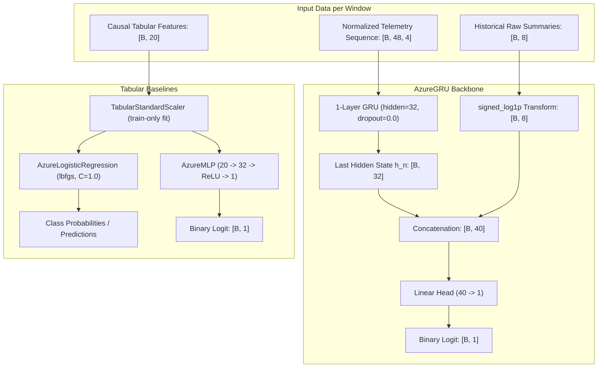

# Predictive Model Design — Azure PdM Baselines (Phase 3)

> **Status: Approved & Verified Implementation.**
> Independently verified by Codex in the feature branch on real data: 118 unit/integration tests passed; Azure and NASA raw manifests passed; full Azure baseline completed all 36 runs (3 models × 3 local clients + centralized pooled across seeds 17, 23, 41) in 993.77s wall; `notebooks/03_Azure_Modeling.ipynb` all 21 cells executed on real Azure data; smoke mode completed 12 runs; zero-shot `heldout_model1` evaluated separately.
> Full benchmark results are preserved in `outputs/phase3_full/results.json` on the feature branch (unavailable in staging; metrics are not invented or copied here).
>
> **Scope & Limitations:** Phase 3 establishes leak-free predictive baselines only. It does not implement federated learning (Phase 4), differential privacy / secure aggregation (Phase 5), maintenance knowledge graphs (Phase 6), or LLM explanations (Phase 7). Due to scarce failure episodes in Azure PdM, positive windows reflect overlapping event horizons rather than independent failure occurrences; baseline results serve as empirical reference points and must not be interpreted as satisfactory research performance or deployment-ready models.

---

## 1. Primary Design Principles

1. **Matched Predictive Backbone Across Strategies:**
   - The identical neural backbone architecture (`AzureGRU`) is used across:
     - **Local-only training** (independent models per participating client).
     - **Centralized training** (pooled participating client reference).
     - **Federated Averaging (FedAvg)** (Phase 4).
     - **FedProx** (Phase 4, with proximal regularizer added to local optimization).
   - This ensures that performance differences across learning strategies reflect the coordination mechanism rather than disparate inductive biases or model capacities.

2. **Dual Benchmark Baselines:**
   - In addition to the sequential `AzureGRU` backbone, two tabular baselines are evaluated on $20$ causal tabular features:
     - `AzureLogisticRegression`: Scikit-learn convex linear baseline.
     - `AzureMLP`: Two-layer neural network matching the GRU training budget.

3. **Strict Causal & Temporal Isolation:**
   - Feature representations are strictly causal and past-only: exactly 48 hourly readings in $[t-48\text{h}, t)$.
   - Zero lookahead: No telemetry reading at prediction timestamp $t$ or later is included in predictors.
   - No same-hour maintenance or error joins.

4. **Zero Cross-Client / Zero Future Parameter Leakage:**
   - Per-window median and IQR normalization uses only the 48 past observations of that window.
   - Tabular feature standardization (`TabularStandardScaler`) is fitted strictly on the caller-provided `train` partition. Fitting on validation, test, or held-out splits raises `HoldoutLeakageError`.

5. **Track Separation:**
   - Azure PdM (binary classification of failure in $(t, t+24\text{h}]$) and NASA C-MAPSS (cycle-level Remaining Useful Life regression) are independent experimental tracks with distinct heads and objectives.

---

## 2. Model Architectures & Mathematical Contracts

### A. Sequence Backbone: `AzureGRU`

Implemented in `src/fedmaint/models/gru.py`.

- **Sequence Input:** Float32 tensor $[B, 48, 4]$ representing normalized sensor readings (`volt`, `rotate`, `pressure`, `vibration`) across timesteps $t-48\text{h}, \dots, t-1\text{h}$.
- **Summary Input:** Float32 tensor $[B, 8]$ representing the deterministic `signed_log1p` transformation of historical sensor statistics:
  $$\text{summary}_{s, \text{stat}} = \text{sign}(x) \cdot \ln(1 + |x|)$$
  for each sensor $s \in \{\text{volt}, \text{rotate}, \text{pressure}, \text{vibration}\}$ and statistic $\text{stat} \in \{\text{median}, \text{IQR}\}$.
- **Recurrent Layer:**
  - Single-layer PyTorch GRU (`input_size=4`, `hidden_size=32`, `num_layers=1`, `batch_first=True`, `dropout=0.0`).
  - Processes sequences without inter-layer dropout (PyTorch 1-layer GRU does not support inter-layer dropout).
- **Combined Representation:**
  - Extracts final hidden state $h_n[0] \in \mathbb{R}^{B \times 32}$.
  - Concatenates $h_n[0]$ with transformed summaries:
    $$\mathbf{z} = [h_n[0] \,\|\, \text{summaries}] \in \mathbb{R}^{B \times 40}$$
- **Classification Head:**
  - Single linear projection: $\text{logits} = \mathbf{z} \mathbf{W}^T + b$, where $\mathbf{W} \in \mathbb{R}^{1 \times 40}, b \in \mathbb{R}^1$.
  - Output shape: $[B, 1]$.
- **Parameter Sharing / FL Interface:**
  - Implements `get_weights() -> Dict[str, torch.Tensor]` returning detached clones of all parameters for federated aggregation.

### B. Tabular Linear Baseline: `AzureLogisticRegression`

Implemented in `src/fedmaint/models/logistic.py`.

- **Features:** 20-dimensional float32 vector per prediction window:
  - For each sensor $s \in \{\text{volt}, \text{rotate}, \text{pressure}, \text{vibration}\}$:
    1. Past median (`{sensor}_median`)
    2. Past IQR (`{sensor}_iqr`)
    3. Last raw reading at $t-1\text{h}$ (`{sensor}_last_raw`)
    4. Last minus first raw delta $(t-1\text{h}) - (t-48\text{h})$ (`{sensor}_last_minus_first_raw`)
    5. Population standard deviation across 48 raw readings (`{sensor}_std_raw`)
- **Classifier Configuration:**
  - Scikit-learn `LogisticRegression(solver='lbfgs', C=1.0, max_iter=1000, random_state=seed)`.
- **Scaling:**
  - Wrapped with `TabularStandardScaler`. Scaler and classifier are fitted strictly on caller-provided training data (`split_name='train'`).
- **Telemetry & Provenance:**
  - Records solver name, convergence status, actual iterations completed, and scikit-learn version.

### C. Tabular Neural Baseline: `AzureMLP`

Implemented in `src/fedmaint/models/mlp.py`.

- **Architecture:**
  - Input layer: Linear $[20 \to 32]$
  - Activation: ReLU
  - Output layer: Linear $[32 \to 1]$ logit
- **Features:** Same 20 causal tabular features as Logistic Regression.
- **Scaling:** Features standardized via train-fitted `TabularStandardScaler`.
- **Training Budget:** Exactly matched to the `AzureGRU` optimization budget (AdamW, lr 1e-3, weight decay 1e-4, batch 512, max 25 epochs, patience 5).
- **Parameter Sharing / FL Interface:** Implements `get_weights()` and `set_weights()` for federated aggregation.

---

## 3. Data Scaling and Leakage Prevention

Implemented in `src/fedmaint/models/scaler.py`.

- **`TabularStandardScaler`:**
  - Computes feature means $\mu_j$ and standard deviations $\sigma_j$ strictly on training data:
    $$\mu_j = \frac{1}{N} \sum_{i=1}^N X_{i,j}, \quad \sigma_j = \sqrt{\frac{1}{N} \sum_{i=1}^N (X_{i,j} - \mu_j)^2}$$
  - **Zero-Variance Safe Fallback:** If $\sigma_j < 10^{-8}$, $\text{scale}_j$ defaults to $1.0$, preventing division by zero without data corruption.
  - **Leakage Guardrail:** Calling `.fit(X, split_name=...)` with any `split_name` other than `'train'` (e.g. `'val'`, `'test'`, `'heldout_model1'`, or `None`) immediately raises `HoldoutLeakageError`.
  - **Inference Immutability:** Calling `.transform(X)` applies the frozen training parameters $(\mu, \sigma)$ without updating statistics. Calling `.transform()` before `.fit()` raises `RuntimeError`.

---

## 4. Training Regimes & Client Partitioning

| Parameter | Local-Only Baseline | Centralized Reference |
| --- | --- | --- |
| **Clients Trained** | 3 independent runs: `client_model2`, `client_model3`, `client_model4` | 1 pooled run combining `model2`, `model3`, and `model4` |
| **Training Partition** | Own client `train` split only | Pooled participating `train` splits |
| **Validation Selection** | Own client `val` split | Unweighted macro AP across participating `val` splits |
| **Decision Threshold** | Selected on own client `val` split (maximizing F1) | Selected on pooled participating `val` split (maximizing F1) |
| **Evaluated Test Sets** | Own client `test` split + zero-shot `heldout_model1` `test` | Per-client `test`, pooled `test`, macro `test`, and zero-shot `heldout_model1` |
| **Privacy Scope** | Local data isolation (no cross-client communication) | Non-private reference (direct data pooling; non-private reference, never a guaranteed upper bound) |

### Strict Held-Out Factory Policy (`heldout_model1`)
- All 16 machines belonging to `model1` are assigned to `heldout_model1`.
- **Zero Exposure:** The `heldout_model1` test cache is built/loaded before training, but is never used in model fitting, validation, hyperparameter tuning, checkpoint selection, or threshold selection.
- **Zero-Shot Test:** Evaluated exclusively on its final `test` split using frozen model weights and frozen validation thresholds.
- Any attempt to query `heldout_model1` for `train` or `val` splits raises `HoldoutLeakageError`.

---

## 5. Optimization, Checkpointing, and Threshold Selection

### A. Optimization Budget
- **Loss Function:** `torch.nn.BCEWithLogitsLoss` (unweighted; no artificial positive weighting or class re-sampling).
- **Optimizer:** `torch.optim.AdamW`.
- **Learning Rate:** $1 \times 10^{-3}$ (constant schedule).
- **Weight Decay:** $1 \times 10^{-4}$.
- **Batch Size:** 512.
- **Maximum Epochs:** 25 (smoke mode: 2).
- **Early Stopping Patience:** 5 epochs (smoke mode: 2).

### B. Validation AP Checkpoint Selection
- Checkpoint metric: **Validation Average Precision (AP / PR-AUC)**.
- **Selection Rule:**
  - Local regime: Monitored on own-client validation AP.
  - Centralized regime: Monitored on unweighted macro validation AP:
    $$\text{Macro AP}_{\text{val}} = \frac{1}{3} \left( \text{AP}_{\text{model2, val}} + \text{AP}_{\text{model3, val}} + \text{AP}_{\text{model4, val}} \right)$$
- **Strict Improvement:** A new checkpoint is saved only if $\text{AP}_{\text{val}} > \text{best\_AP}_{\text{val}}$ (strict inequality). On ties, the earlier epoch is retained.
- Model weights from the best validation epoch are restored before test evaluation.

### C. Validation-Only F1 Threshold Selection
Implemented in `src/fedmaint/evaluation/threshold.py`.

- Evaluates candidate decision thresholds $\tau \in [0, 1]$ over validation predicted probabilities in $O(N \log N)$ time via cumulative prefix sweeps.
- **Objective:** Maximize F1 score:
  $$\tau^* = \arg\max_{\tau} F_1(\tau; y_{\text{val}}, \hat{p}_{\text{val}})$$
- **Deterministic Tie-Breaker:** If multiple thresholds achieve the identical maximum F1 score, the **highest threshold** is selected (conservative alarm policy).
- Test partitions and held-out data are strictly prohibited from threshold selection.

---

## 6. Execution Modes & Configuration

Configured in `configs/phase3_azure.json`:

| Parameter | Smoke Mode (`--mode smoke`) | Full Mode (`--mode full`) |
| --- | --- | --- |
| **Approved Seeds** | `[17]` | `[17, 23, 41]` |
| **Max Epochs** | 2 | 25 |
| **Patience** | 2 | 5 |
| **Bootstrap Draws** | 30 | 1000 |
| **Subset Bounding** | Stratified bounded subset ($\le 60$ samples per partition) | Full dataset partitions |
| **Purpose** | Pipeline verification & plumbing validation | Scientifically representative baseline evaluation |
| **Interpretation** | **Plumbing only; strictly non-representative** | **Representative performance baseline** |

---

## 7. Downstream Interfaces & Future Phases

1. **Federated Learning (Phase 4):**
   - `AzureGRU` and `AzureMLP` expose detached parameter state dicts via `get_weights()` and aggregated parameter injection via `set_weights()`.
   - The same client partitions, observation windows, and validation thresholding rules will govern FedAvg and FedProx rounds.
2. **Maintenance Knowledge Graph (Phase 6):**
   - The predictive backbone produces failure probabilities and emitted alerts.
   - KG construction and retrieval operate strictly post-prediction to ground downstream explanations. No Graph Neural Network (GNN) is embedded in the time-series predictor.
3. **LLM Explanations (Phase 7):**
   - Grounded explanation prompts consume model probability scores and retrieved local KG facts.
