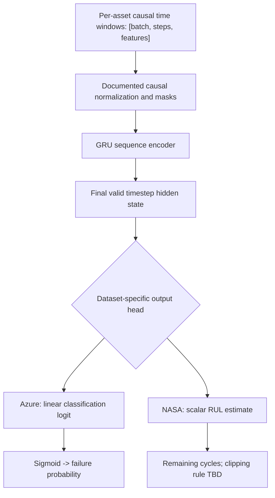

# Phase 1 — Predictive Model Design (Draft)

> **Not trained or selected by benchmarking.** This is a simple, testable candidate intended for a matched Local / Centralized / Federated comparison. Architecture and hyperparameters are subject to Phase 2 EDA and baseline results.

## Primary principle

Use **the same architecture** for each algorithm being compared **within the same dataset**:

- **Local-only training** per participating client.
- **Centralized training** on permitted pooled benchmark records (offline comparison only).
- **Federated averaging (FedAvg)**.
- **FedProx** on the same backbone, optimizer budget and prediction task.

Do **not** assume the Azure classifier weights are compatible with NASA RUL regression. These are separate models with common training utilities.

## Candidate neural backbone

A small **GRU** is proposed as the first comparable time-series model. A simple tabular baseline can be added before it to verify feature engineering, but model-vs-training-strategy comparisons must use the same GRU backbone.

### Starting hyperparameter candidates (not final)

| Parameter | Azure candidate | NASA candidate | Notes |
| --- | --- | --- | --- |
| Observation length | 48 hours | 30 cycles | Subject to EDA and ablation |
| Inputs | Four telemetry sensors, plus separately tested causal event-history features | 3 operational settings + 21 sensor channels | Remove noninformative channels only from training-derived statistics |
| GRU | 1–2 layers, hidden width 64 | 1–2 layers, hidden width 64 | Select one matched configuration per track |
| Output | One **logit** per machine/timepoint | One scalar RUL estimate per engine/cycle | Task-specific heads |
| Optimization | Adam + BCEWithLogitsLoss | Adam + MSE/Huber candidate | Class weighting based on training only |
| Primary score | PR-AUC (F1 secondary) | RMSE + NASA score | Use identical score definitions across learning strategies |

A one-layer PyTorch GRU does not apply inter-layer dropout; if using dropout, specify a separate layer or multiple GRU layers and document its location.

## Data inputs

### Azure (track A)

**First feature set:** normalized `volt`, `rotate`, `pressure`, `vibration` readings over a causal fixed window.

**Second feature set (ablation):** optionally add timestamp-safe error-count or maintenance-recency features, grouped by machine and component. Avoid a model-ID embedding that assumes the held-out machine model ID was learned at training time; test how the system handles unseen categories.

Output: **any-component machine-failure risk in a proposed future 24-hour horizon**, subject to final label design and event cleaning.

### NASA (track B)

Input: engine-level windows of 3 operational settings + 21 sensors, followed by training-only selection of usable channels.

Output: RUL in **engine cycles**, with a documented choice of raw or capped targets. Don't use Azure-style error/maintenance features; NASA does not provide them.

## Federated parameter sharing

For a chosen dataset, all clients must construct input tensors with **identical feature order and dimensions** before any federated averaging. Local fitted normalization may differ but requires a documented evaluation protocol, especially for a strict held-out client.

At each round:

1. Coordinator sends the current **global model parameters** and round configuration.
2. Participating clients train on their own windows and send model updates/weights according to the FL strategy.
3. A privacy-processing component is applied at the appropriate point **once its threat model is specified**.
4. Coordinator performs **FedAvg** (sample-count-weighted aggregation) or **FedProx** training (local proximal regularizer, aggregation as specified).
5. Record round number, participating clients, local sample counts, bytes communicated, wall time and validation metrics.

**Note:** FedProx is not just changing the aggregation formula; its defining proximal term belongs in local optimization. The exact FL algorithm and privacy protocol must be implemented and tested; the diagram alone is not sufficient.

## Evaluation and safeguards

- Construct a **single agreed evaluation split** per dataset, reused for all matched training strategies.
- Choose classification thresholds using **training-participant validation only**, not unseen-factory results.
- Fix deterministic seeds, clients' sample counts, preprocessing, optimizer choices and reasonable compute budgets.
- Account for overlapping windows and class imbalance. Log both per-client and pooled/held-out results.
- NASA official test-RUL labels are for scoring; do not use them in hyperparameter search.
- Compare model quality and communication/compute trade-offs. Don't claim FL beats centralized learning without data.

## Explainability is a downstream subsystem

The first predictive backbone is a **GRU, not a graph neural network**. The local KG retrieves evidence **after** predictions to ground the LLM's explanation. This keeps training-strategy comparisons clear and makes a **no-KG** ablation meaningful. An integrated GNN can be evaluated as a future extension rather than being assumed essential.

## Work order

1. Phase 1: agree on target + split + feature contract, GRU option and held-out protocol.
2. Phase 2: build leak-free windows and add unit tests for features/labels/splits.
3. Phase 3: test trivial predictors + GRU local and centralized baselines.
4. Phase 4: reuse GRU for FedAvg / FedProx; check numerical correctness on toy cases.
5. Phase 5+: select privacy mechanism, KG, explanation pipeline and ablations.

See [DATA_FLOW.md](DATA_FLOW.md) for complete ingestion and boundary rules.
